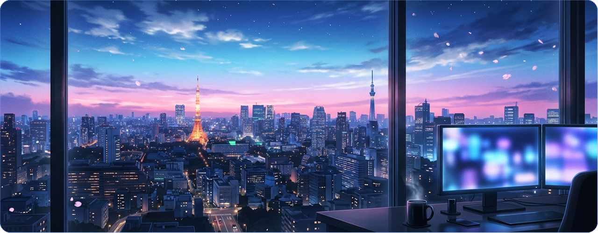
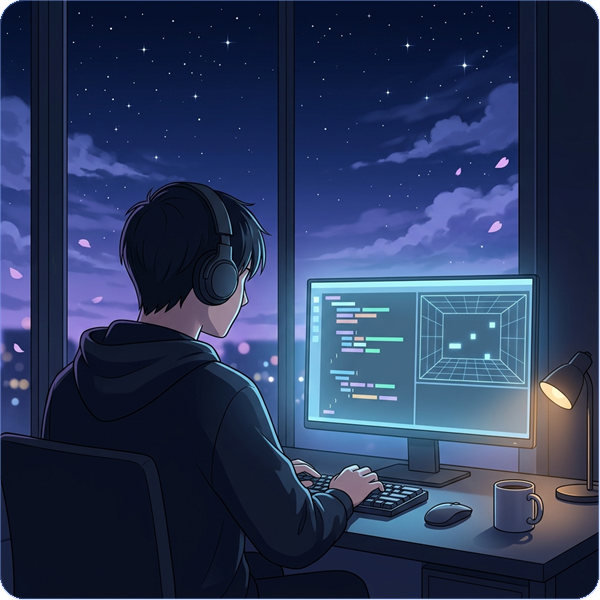

  

✦ &nbsp; ようこそ · WELCOME TO MY DIGITAL SPACE &nbsp; ✦

# Aditya Anugrah

 

 

  

## About Me &nbsp;·&nbsp; プロフィール

<table>
  <tr>
    <td width="62%" valign="top">
      

        Hi, I'm <b>Aditya Anugrah</b> (<code>@Ditnzyyyvv</code>) — a passionate student developer at
        <a href="https://smkifsu.sch.id/" target="_blank"><b>SMKS Informatika Sumedang</b></a> who enjoys turning ideas
        into clean web applications and expressive interactive games.
      

      

        Inspired by storytelling and atmosphere in anime and indie games, I aim to write maintainable code while
        crafting thoughtful, memorable user experiences.
      

      <ul>
        <li>💻 <b>Primary Focus:</b> Full-Stack Web Development with <b>Laravel, PHP, TypeScript & JavaScript</b></li>
        <li>🎮 <b>Creative Craft:</b> Indie Game Development in <b>Godot Engine (GDScript)</b> & Mobile Apps with <b>Flutter / Dart</b></li>
        <li>🌱 <b>Currently Leveling Up:</b> Clean code architecture, modern UI/UX systems, & software craftsmanship</li>
        <li>🎙️ <b>Beyond Code:</b> Continuously sharpening <i>Public Speaking</i> & collaborative team communication</li>
        <li>✨ <b>Philosophy:</b> <i>"Love yourself and never stop learning."</i></li>
      </ul>
    </td>
    <td width="38%" align="center" valign="middle">
      
    </td>
  </tr>
</table>

  

## Featured Works &nbsp;·&nbsp; 作品集

<table>
  <tr>
    <td width="50%" valign="top">
      <h3>🧪 <a href="https://github.com/Ditnzyyyvv/SiLab">SiLab</a></h3>
      

        A web platform built for managing, tracking, and maintaining school laboratory assets with a clean administrative workflow.
      

      

        <code>Laravel</code> &nbsp;<code>Blade</code> &nbsp;<code>PHP</code>
      

    </td>
    <td width="50%" valign="top">
      <h3>🏛️ <a href="https://github.com/Ditnzyyyvv/Museumism">Museumism</a></h3>
      

        An interactive virtual memory museum preserving unforgettable fictional characters across anime, cinema, games, and series.
      

      

        <code>Godot Engine</code> &nbsp;<code>GDScript</code> &nbsp;<code>Interactive Art</code>
      

    </td>
  </tr>
  <tr>
    <td width="50%" valign="top">
      <h3>✒️ <a href="https://github.com/Ditnzyyyvv/Game-LoveablePen">Game-LoveablePen</a></h3>
      

        An original indie game crafted with Godot Engine and published to be accessible and playable directly via itch.io.
      

      

        <code>Godot Engine</code> &nbsp;<code>Indie Game</code> &nbsp;<code>Itch.io</code>
      

    </td>
    <td width="50%" valign="top">
      <h3>🗺️ <a href="https://github.com/Ditnzyyyvv/Wisata-Nusan">Wisata-Nusan</a></h3>
      

        A tourism showcase and web application developed for the Competency Certification (Serkom) at SMKS Informatika Sumedang.
      

      

        <code>Laravel</code> &nbsp;<code>Blade</code> &nbsp;<code>Web App</code>
      

    </td>
  </tr>
</table>

  
    More builds:
    <a href="https://about-me-icso1.vercel.app/" target="_blank"><b>AboutMe Portfolio</b></a> (TypeScript) ·
    <a href="https://github.com/Ditnzyyyvv/Nyerocos.id"><b>Nyerocos.id</b></a> (Indonesian Topic Generator) ·
    <a href="https://github.com/Ditnzyyyvv/Slip-Gaji-Serkom"><b>Slip-Gaji-Serkom</b></a> (PHP Payroll System)
  

  

## Tech Stack & Arsenal &nbsp;·&nbsp; 技術スタック

| Domain | Technologies |
| :---: | :--- |
| **Web & Mobile** |  |
| **Game Dev & Design** |  |
| **Workflow & Tools** |  |

  

## GitHub Analytics &nbsp;·&nbsp; 統計

  
  &nbsp;
  

  

  

## Connect With Me &nbsp;·&nbsp; 連絡先

  
  
  
  
  
  

 

  

